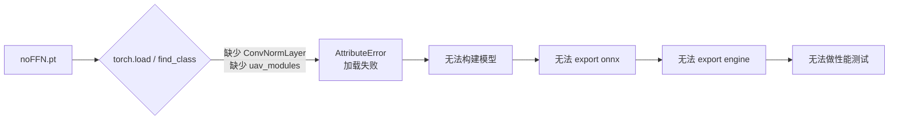

# noFFN.pt 导出 TensorRT engine 可行性报告

- 日期：2026-09-29
- 对象文件：`noFFN.pt`（41,487,597 字节 / 39.6 MiB，2026-09-29 15:50 写入）
- 目标：导出为 `.engine`（TensorRT）并测试性能
- 报告主机：Jetson Orin NX（aarch64 / Tegra），JetPack R35.6.4，TensorRT 8.5.2，Ultralytics 8.4.89

---

## 1. 结论（先给答案）

**当前环境下 `noFFN.pt` 无法导出 `.engine`，也无法导出 `.onnx`——它在第一步 `torch.load()` 就已经失败。**

原因不是 TensorRT、不是 GPU、不是 `--half` 或 `imgsz` 参数，而是：**这份权重依赖一套自定义 Ultralytics 代码（`uav_modules` 及被改造过的 `block.py`），而这套代码没有安装在本机。** 缺少这些类，PyTorch 连权重都反序列化不了，后续的“导出/性能测试”无从进行。

因此这次**没有得到任何性能数据**：没有可运行的模型，就没有可测量的延迟/FPS。这属于“被阻断”，不是“跑出来结果差”。

---

## 2. 这份权重到底是什么

通过解析 checkpoint 内部结构（方法与命令见第 6 节），可以确认：

| 项目 | 值 |
| --- | --- |
| 模型家族 | **RT-DETR**（`ultralytics.nn.tasks.RTDETRDetectionModel`），**不是 YOLO** |
| 具体配置 | **`SO-DETR-R18-NoFFT`**（ResNet-18 骨干 + “NoFFT” 自定义模块） |
| 任务 | detect（目标检测） |
| 类别数 | `nc = 10` |
| 类别名 | pedestrian, people, bicycle, car, van, truck, tricycle, awning-tricycle, bus, motor |
| 数据集 | **VisDrone2019-DET**（无人机航拍数据集，10 类） |
| 参数量 | 约 **20.57 M** |
| 保存版本 | Ultralytics **8.0.201**（本机为 8.4.89，不一致） |
| 保存时间 | 2026-09-29 05:27 UTC |
| 训练配置路径 | `/home/ubuntu/文档/ZHJ_UAV/SO_DETR/ultralytics/cfg/models/SO-DETR-R18-NoFFT.yaml` |
| 序列化方式 | 使用 `dill` 保存（非标准 pickle） |

**要点：这是一个在“魔改过的 Ultralytics 分支”里训练出来的无人机航拍检测模型，骨干是 ResNet-18，检测头是 RT-DETR 的可变形注意力解码器。** 它和本仓库 README 里作为默认模型的 `yolo11s`（COCO 80 类 YOLO11s）完全是两套体系。

---

## 3. 为什么导出不了（根因 + 证据）

### 3.1 直接错误

按仓库现有导出脚本 `export_yolo_onnx_engine.py` 的方式加载，报错为：

```text
AttributeError: Can't get attribute 'ConvNormLayer'
on <module 'ultralytics.nn.modules.block'>
```

即：`noFFN.pt` 里 pickle 记录了 `ultralytics.nn.modules.block.ConvNormLayer` 这个类，但本机安装的 Ultralytics 里根本没有它。`torch.load()` 在 `find_class` 阶段失败，权重根本没被读出来。

### 3.2 缺失的类清单

逐项核对“权重里引用到的类”与“本机是否存在”：

| 权重引用的类 | 所属模块 | 本机状态 |
| --- | --- | --- |
| `ConvNormLayer` | `ultralytics.nn.modules.block` | **缺失**（自定义新增，权重中出现 23 处） |
| `Blocks` | `ultralytics.nn.modules.block` | **缺失**（自定义新增，4 处） |
| `BasicBlock` | `ultralytics.nn.modules.block` | **缺失**（自定义新增，8 处） |
| `DDFNoFFT` | `ultralytics.nn.uav_modules.block` | **整个模块缺失** |
| `FFMNoFFT` | `ultralytics.nn.uav_modules.block` | **整个模块缺失** |
| `ImprovedNoFFTKernel` | `ultralytics.nn.uav_modules.block` | **整个模块缺失** |
| `SPDConv` | `ultralytics.nn.uav_modules.block` | **整个模块缺失** |
| `RepC3` / `RepConv` / `RTDETRDecoder` / `AIFI` / `MSDeformAttn` / `RTDETRDetectionModel` … | 官方 ultralytics | 存在 |

也就是说，作者**同时改了两处**：

1. 往 `ultralytics/nn/modules/block.py` 里加了 `ConvNormLayer` / `Blocks` / `BasicBlock`（相当于把 ResNet 的 BasicBlock 挪了进来）；
2. 新建了一个官方仓库里不存在的包 `ultralytics/nn/uav_modules/`，里面放了 `DDFNoFFT`、`FFMNoFFT`、`ImprovedNoFFTKernel`、`SPDConv` 四个自定义算子。

这两块源码在本机（乃至整个 `$HOME`）都搜不到，训练时用的那份 fork 没有随权重一起交付。

### 3.3 从模型 YAML 直接看到的自定义算子

模型结构（由 checkpoint 内嵌的 `yaml` 还原）在骨干和颈部用了这些非官方模块：

```text
backbone:
  [-1, 1, 'ConvNormLayer', [32, 3, 2, 'None', False, 'relu']]   # 自定义
  [-1, 1, 'Blocks', [64, 'BasicBlock', 2, 2, 'relu']]           # 自定义
  ...
head:
  [-1, 1, 'AIFI', [1024, 8]]                 # 官方
  [4,  1, 'SPDConv', [128]]                  # 自定义（uav_modules）
  [-1, 1, 'DDFNoFFT', []]                    # 自定义（uav_modules）
  [[20, 23, 26], 1, 'RTDETRDecoder', ['nc', 256, 300, 4, 8, 3]]  # 官方 RT-DETR 头
```

### 3.4 失败链路



### 3.5 其他叠加风险（即使拿到源码也需要留意）

- **版本漂移**：权重用 8.0.201 保存，本机是 8.4.89。RT-DETR 相关 API（`RTDETRDecoder`、`AIFI`、loss）在两者间可能有签名差异，需要按 8.0.201 对齐。
- **自定义算子的可导出性**：`ImprovedNoFFTKernel` 名字里带 “Kernel”，极可能是自定义 CUDA/注意力算子。这类算子通常**没有对应的 ONNX 算子**，TensorRT 8.5 也不会自带实现，**即使模型能加载，导出 ONNX/TensorRT 仍很可能失败，或需要配套的 TensorRT plugin**。这一条属于**风险提示，尚未实测**（因为模型当前根本加载不了）。
- **RT-DETR 本身的导出复杂度**：可变形注意力（`MSDeformAttn`）+ 解码器的导出路径比 YOLO 复杂，Jetson 上常需专门处理。
- **用 `dill` 序列化**：进一步说明它来自一个“非标准”训练环境。

**注意：用占位类（stub）可以骗过反序列化、读出模型结构（本报告第 2、3 节的数据就是这么得到的），但占位类没有 `forward()`，模型无法前向、也无法导出。** 也就是说，“能读出结构”≠“能用”。

---

## 4. 怎样才能导出（可行路径）

要导出 `noFFN.pt`，必须补齐它的“出生环境”，按优先级：

**方案 A（推荐）：拿到原始 SO-DETR fork，在原环境导出**
需要交付/获取：
1. 训练时用的 Ultralytics fork（版本对齐 8.0.201），其中包含：
   - 改造版 `ultralytics/nn/modules/block.py`（含 `ConvNormLayer`、`Blocks`、`BasicBlock`）；
   - 新增包 `ultralytics/nn/uav_modules/`（含 `DDFNoFFT`、`FFMNoFFT`、`ImprovedNoFFTKernel`、`SPDConv`）。
2. 该环境里把 `ConvNormLayer` 等注册好之后：
   ```bash
   yolo export model=noFFN.pt format=onnx  imgsz=640 opset=12 simplify=True
   yolo export model=noFFN.pt format=engine imgsz=640 half=True device=0
   ```
3. 若 `ImprovedNoFFTKernel` 无 ONNX 实现，需要作者提供 TensorRT plugin 或改写成可导出形式。

**方案 B：直接向模型作者索取**
请训练者直接给出 **在该 fork 环境里已导出的 `noFFN.onnx` 或 `noFFN.engine`**（连同 `uav_modules` 源码），避免二次环境搭建的返工。

**方案 C（不推荐）：纯靠结构复刻**
仅凭 checkpoint 结构无法还原 `DDFNoFFT/FFMNoFFT/ImprovedNoFFTKernel` 的**前向计算**（只有权重，没有算法）。强行用占位实现会得到**静默错误的检测结果**，不能用于性能/精度评估，不可取。

---

## 5. 与本仓库现有模型的关系

- 本仓库默认走的是 `yolo11s.pt` → `yolo11s.engine`（标准 YOLO11s，COCO 80 类），**这套是能正常导出和运行的**，仓库里已有 7 月导出的 `yolo11s.engine`。
- `noFFN.pt` 是**另一套体系**（RT-DETR / VisDrone / 无人机航拍 10 类），与现有代码的类别名表、`--names-*` 逻辑、`--save-classes` 匹配都不通用。即便将来导出成功，也需要**单独准备 VisDrone 的 10 类名称表**，并按 RT-DETR 的输入/后处理方式适配检测脚本。
- README 中“未验证 A8 mini 真机网络、Orin NX 硬解码、TensorRT 性能或长时间稳定性”的说明，指的是 `yolo11s.engine` 那套；与本次 `noFFN.pt` 的导出问题是两回事。

---

## 6. 复现与验证命令

本报告的数据由以下**只读**探测得到（未修改权重、未改动环境代码）：

```bash
# 1) 直接加载：复现失败
python3 -c "from ultralytics import YOLO; YOLO('noFFN.pt')"
#   -> AttributeError: Can't get attribute 'ConvNormLayer' ...

# 2) 核对缺失的类
python3 - <<'PY'
import ultralytics, os
from ultralytics.nn.modules import block
print("version:", ultralytics.__version__)
for n in ["ConvNormLayer","Blocks","BasicBlock","RepC3"]:
    print(n, hasattr(block, n))
print("uav_modules exists:", os.path.exists(
    os.path.join(os.path.dirname(ultralytics.__file__),"nn","uav_modules")))
PY

# 3) 解析 checkpoint 内引用的类（pickletools）
# 4) 注入占位类后读取 model.yaml / 参数量（见 /tmp/probe_noffn.py）
```

- 环境：Python 3.8.10、torch 2.1.0a0+nv23.6、ultralytics 8.4.89、TensorRT 8.5.2.2、OpenCV 5.0.0.93。
- 已安装 `dill`（`noFFN.pt` 用 dill 保存，缺它甚至到不了 `ConvNormLayer` 那一步）。

---

## 7. 一句话总结

`noFFN.pt` 是别人在**魔改版 Ultralytics（SO-DETR / uav_modules）**里训练出来的 RT-DETR 航拍检测模型；**能否导出，取决于能不能拿到那套自定义源码，而不是取决于本机算力**。在补齐 `ConvNormLayer`、`Blocks`、`BasicBlock` 和 `uav_modules`（`DDFNoFFT`/`FFMNoFFT`/`ImprovedNoFFTKernel`/`SPDConv`）之前，**导出与性能测试都无法开始**。最省事的做法是直接向作者索取**在同源环境里已导出的 engine/onnx 或完整 fork 代码**。

---

## 8. 更新（2026-09-30）：已成功导出 ✅

拿到 **SO-DETR fork 源码**（仓库内 vendored `ultralytics` **8.0.201**，含 `uav_modules` 与改造版 `block.py`）后，按方案 A 导出**全部成功**——印证了第 7 节的判断：**卡点是缺源码，不是算力**。

### 8.1 关键设置（踩过的坑）

| 项 | 结论 |
| --- | --- |
| 运行方式 | 必须在 `SO_DETR/` 目录下并设 `PYTHONPATH=$PWD`，用 `/usr/bin/python3.8`（fork 8.0.201 == 权重保存版本；系统里 pip 装的 8.4.89 会因缺自定义类而失败） |
| ONNX | `format='onnx'` 默认 **opset 17** 可直接成功，输出 `[1,300,14]` |
| engine | 必须 **`opset=16` + `half=False`**（见下） |
| 精度 | ultralytics `half=True` 导出失败，故 engine 走 **FP32**；FP16 另用 `trtexec` 生成 |

engine 的 opset 选择：
- **opset 17** → 生成 `LayerNormalization` 节点，**TensorRT 8.5.2 无法导入**（`Plugin not found`）；
- **opset 12** → `grid_sampler`（RT-DETR 可变注意力用）不支持，需 ≥16；
- **opset 16** → `LayerNorm` 被拆成基础算子、`grid_sampler` 可用 → **导入成功**。

### 8.2 需要修改的一行代码

`ultralytics/nn/uav_modules/block.py` 的 `DDFNoFFT.forward`：

```python
# 改前（ONNX 追踪时报 TypeError，无法导出）
active_channels = round(x.size(1) * self.e)
active, bypass = torch.split(self.cv1(x), [active_channels, x.size(1) - active_channels], dim=1)

# 改后（可追踪，数值等价）
channels = self.cv1.conv.out_channels
active_channels = round(channels * self.e)
active, bypass = torch.split(self.cv1(x), [active_channels, channels - active_channels], dim=1)
```

含义：`DDFNoFFT` 按通道把输入一分为二——`active` 走 `self.m`，`bypass` 直通，再 `cat` 回去；`active_channels = round(通道数 × self.e)`（`self.e=0.25`）。
- 原写法用 `x.size(1)`（运行时输入通道数），在 ONNX **追踪**时会变成符号量（Tensor），`round(Tensor)` 报 `type Tensor doesn't define __round__`；
- 新写法用 `self.cv1.conv.out_channels`，是**静态 Python int**（`cv1` 是 `dim→dim` 的 1×1 卷积，输入通道恒等于 `dim`）；
- 两者数值完全等价，**只影响“能否追踪导出”，不改变训练/推理结果**。

### 8.3 导出命令

```bash
cd SO_DETR
# ONNX
PYTHONPATH="$PWD" /usr/bin/python3.8 -c \
"from ultralytics import RTDETR; RTDETR('noFFN.pt').export(format='onnx', imgsz=640)"
# Engine（FP32，opset 16）
PYTHONPATH="$PWD" /usr/bin/python3.8 -c \
"from ultralytics import RTDETR; RTDETR('noFFN.pt').export(format='engine', imgsz=640, half=False, device=0, opset=16)"
```

### 8.4 产物与校验

| 文件 | 大小 | 精度 | SHA-256（前 8 位） |
| --- | --- | --- | --- |
| `noFFN.onnx` | 81,717,903 B | opset 16 | `34565b03` |
| `noFFN.engine` | 85,137,338 B | FP32 | `ac24d8dd` |
| `noFFN_fp16.engine` | 44,406,398 B | FP16 | `336228f0` |

- 输入 `images [1,3,640,640]`，输出 `output0 [1,300,14]`（300 query × 4 box + 10 类）。
- `onnx.checker` 通过；255 个 initializer **无 NaN**；engine 推理正常。
- 用 RT-DETR 后处理（`RTDETR(...)`）在 `train_batch0.jpg` 上：`.pt` 与 **FP32 engine 均为 92 框**（坐标基本重合）；**FP16 engine 89 框**（少数框因 FP16 舍入跌到 conf 阈值以下）。

### 8.5 推理用法（重要）

engine/onnx **必须用 `RTDETR(...)` 预测器**（RT-DETR 的后处理与 YOLO 不同：要把输出 `[300, 4+nc]` 拆成 box/score 再按原图尺寸还原）。用 `YOLO(...)` 会得到**错误结果**（实测只剩 11 个 1~3px 的框）。

```bash
cd SO_DETR
PYTHONPATH="$PWD" /usr/bin/python3.8 - <<'PY'
from ultralytics import RTDETR
model = RTDETR('noFFN_fp16.engine')          # 或 noFFN.engine / noFFN.onnx
results = model.predict('your.jpg', imgsz=640, conf=0.25, save=True)
for r in results:
    print(r.path, len(r.boxes), 'boxes | names:', r.names)
PY
```

为让 fork 能推理导出的模型，改了仓库两处（**不影响训练**）：
1. `ultralytics/models/rtdetr/model.py`：放开 `RTDETR` 仅允许 `.pt/.yaml/.yml` 的限制，增加 `.onnx/.engine/.trt`；
2. `ultralytics/models/rtdetr/predict.py`：`postprocess` 兼容两种模型输出——`.pt`（nn.Module）返回 `(y, x)` 元组，`AutoBackend`（onnx/engine）直接返回张量 `y`。

另外 fork 的 `AutoBackend` 要求 engine 文件**开头带 metadata 头**（4 字节长度 + JSON）；ultralytics 导出的 engine 自带，`trtexec` 导出的裸 engine 需手动把该头前置才能被加载。

### 8.6 FP16 的生成（绕过 `half=True` 失败）

```bash
/usr/src/tensorrt/bin/trtexec --onnx=noFFN.onnx \
  --saveEngine=noFFN_fp16.engine --fp16 --workspace=4096
# 再把 noFFN.engine 的前 523 字节（metadata 头）前置到 noFFN_fp16.engine
```