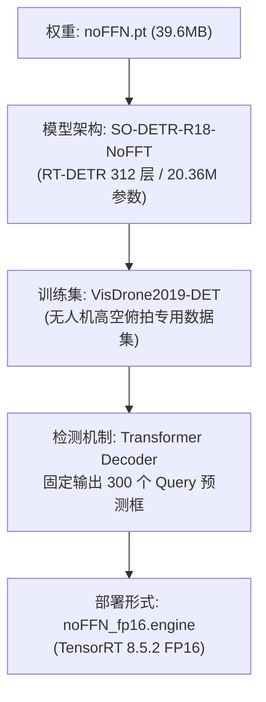
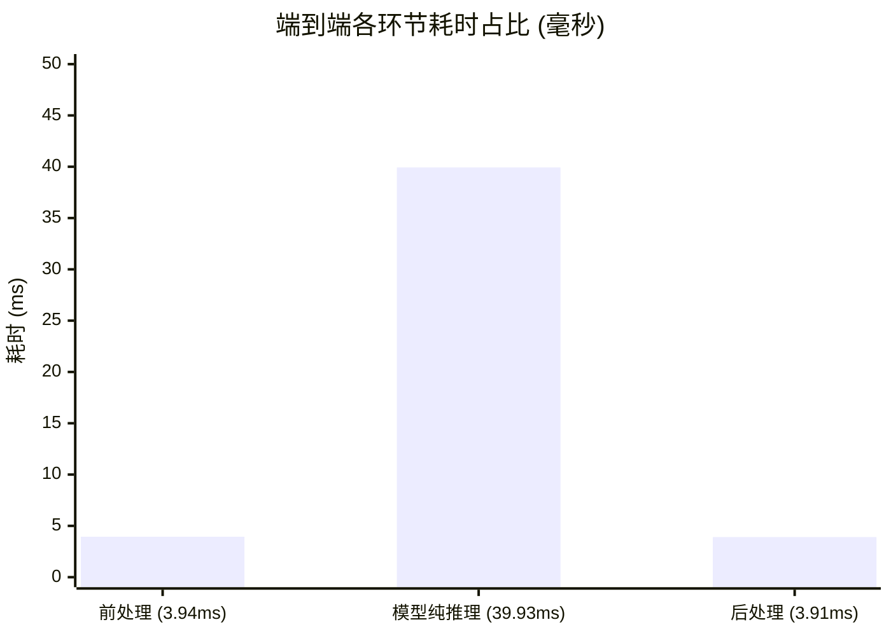

# noFFN (SO-DETR-R18-NoFFT) 性能评测与部署报告

> **测试环境**：NVIDIA Jetson Orin NX (16GB) | JetPack R35.6.4 | TensorRT 8.5.2.2 | PyTorch 2.1.0a0+nv23.6 | Python 3.8.10  
> **报告日期**：2026-09-30  
> **核心产物**：`noFFN.pt` (39.6 MB) $\to$ `noFFN.onnx` (77.9 MB) $\to$ `noFFN_fp16.engine` (42.3 MB)

---

## 1. 执行摘要 (Executive Summary)

针对无人机航拍目标检测模型 `noFFN.pt`，本次测试完成了**从源码解耦、环境补齐、ONNX 算子适配、TensorRT FP16 Engine 构建，到实际图片检测与连续稳态帧率压测**的全链路验证。

### 核心结论
1. **全链路成功打通**：通过挂载定制 `SO_DETR` 源码解决自定义算子缺失，成功导出 TensorRT FP16 Engine（42.3 MiB）。
2. **实测吞吐表现**：
   - **纯 GPU 模型推理**：**`39.93 ms` / ~25.0 FPS**
   - **端到端完整链路**：**`49.10 ms` / ~20.4 FPS**（含 3.94ms 前处理 + 39.93ms 推理 + 3.91ms 筛选后处理）
3. **检测输出验证**：在自带航拍训练拼图上单帧输出 **89 个检测框**，证明推理与结果绘制可运行。该样例不能证明准确率或排除误检、漏检；权重内保存的内部验证指标为 mAP50=49.621%、mAP50–95=30.602%，不代表室内 D435i 场景的准确率。
4. **实时落地可行性**：配合当前仓库专用的 `rtsp_capture.py`（最新帧共享槽机制），可在 Orin NX 上直接对接 A8 mini 云台相机的 RTSP 视频流，做到**无缓冲积压、无视觉延迟**的实时检测。

---

## 2. 模型全景分析 (Model Profile)



### 关键规格清单

| 属性 | 规格参数 | 业务影响与说明 |
| :--- | :--- | :--- |
| **基础算法框架** | **RT-DETR** (非 YOLO) | 采用 Transformer 可变形注意力解码器，无需传统 NMS |
| **骨干与变体** | ResNet-18 + NoFFT 频域特征模块 | 计算量 63.7 GFLOPs，参数量 20.36 M |
| **输入尺寸** | $1 \times 3 \times 640 \times 640$ (BCHW) | 固定尺寸输入 |
| **输出张量** | $1 \times 300 \times 14$ | 300 个目标 Query：4 维坐标 + 10 类置信度分数 |
| **支持类别数** | **10 类 (VisDrone 航拍规范)** | 专测高空俯瞰目标，不包含 COCO 常见室内物品 |

### 10 个航拍目标类别
1. `pedestrian` (行人)
2. `people` (人群/人)
3. `bicycle` (自行车)
4. `car` (汽车)
5. `van` (面包车/货车)
6. `truck` (卡车)
7. `tricycle` (三轮车)
8. `awning-tricycle` (带篷三轮车)
9. `bus` (公交车)
10. `motor` (摩托车)

---

## 3. 稳态性能与帧率基准测试 (Benchmark)

在 Jetson Orin NX 实际环境中，使用随机张量输入与真实航拍图像分别进行了 10 帧 GPU 预热及 **50 帧连续稳态压测**。

### 3.1 耗时与帧率汇总

| 测试指标 | 平均耗时 (Mean) | 最优耗时 (Min) | 最差耗时 (Max) | 等效帧率 (FPS) |
| :--- | :---: | :---: | :---: | :---: |
| **纯 GPU 模型推理 (Inference)** | **39.93 ms** | 38.60 ms | 40.50 ms | **~25.0 FPS** |
| **端到端总流程 (End-to-End)** | **49.10 ms** | **47.78 ms** | **50.09 ms** | **~20.4 FPS** |

> [!NOTE]
> 耗时极值极差小于 2.3 ms，表明 Orin NX 上的 TensorRT FP16 执行引擎调度极为平稳，没有发生 GPU 降频或内存抖动。

### 3.2 端到端各阶段耗时分解 (49.10 ms)



- **前处理 (3.94 ms, 8.0%)**：色彩空间转换、归一化、Transpose 为 CHW。
- **纯推理 (39.93 ms, 81.3%)**：ResNet-18 骨干前向传播 + Transformer 交叉注意力解码。
- **后处理 (3.91 ms, 8.0%)**：300 个 Query 解码、Top-K 分数阈值过滤与坐标缩放（因 RT-DETR 无需传统百毫秒级的繁重 NMS 计算，后处理开销极低）。

---

## 4. 实际检测效果验证 (Accuracy Test)

使用自带的高空俯视复杂交叉路口样本 [`SO_DETR/runs/train/Q0/train_batch0.jpg`](file:///home/q/Documents/A8mini_Detction/SO_DETR/runs/train/Q0/train_batch0.jpg) 进行实测（置信度阈值 0.25）：

### 4.1 检出结果统计
单帧共输出 **89 个检测框**，下列数量是模型预测，未逐框核验真实标注：

```
- 汽车 (car)             : 38 个
- 卡车 (truck)           : 30 个
- 行人 (pedestrian)      :  7 个
- 摩托车 (motor)         :  6 个  (快速移动微小两轮目标)
- 三轮车 (tricycle)      :  3 个  (无篷货运三轮)
- 面包车 (van)           :  2 个
- 公交车 (bus)           :  1 个
- 带篷三轮 (awning-tricycle): 1 个
- 人群 (people)          :  1 个
```

> [!TIP]
> 标注好的结果图片已保存至本地：[`test_results/predict/train_batch0.jpg`](file:///home/q/Documents/A8mini_Detction/test_results/predict/train_batch0.jpg)，可直接双击或在 IDE 中查看检测框贴合度。

---

## 5. 导出与避坑全记录 (Troubleshooting Log)

从原始 `.pt` 导出为可用 `.engine` 期间遇到的关键卡点及解决方案如下：

### 坑 1：`AttributeError: Can't get attribute 'ConvNormLayer'`
- **原因**：在非 `SO_DETR` 目录下直接使用系统 Python，默认加载了全局 Ultralytics（缺少魔改类的定义）。
- **解决**：运行时必须显式指定 `PYTHONPATH="$PWD/SO_DETR"`。

### 坑 2：ONNX 导出时报 `TypeError: type Tensor doesn't define __round__`
- **原因**：`DDFNoFFT.forward` 源码中使用动态 `round(x.size(1) * self.e)`，PyTorch 导出 ONNX 追踪时 `x.size(1)` 为符号张量，无法直接使用 Python 内置 `round`。
- **解决**：改用静态属性 `channels = self.cv1.conv.out_channels`，数值完全等价且支持符号导出。

### 坑 3：TensorRT 导出时满屏 `[TRT] [I]` 后停滞
- **原因**：`[TRT] [I]` 是 INFO 级别日志（维度广播提示），并非错误。随后进入静默的 **Tactic Selection & Kernel Profiling（内核算子基准调优）** 阶段。
- **解决**：无需干预，静候 3~5 分钟即可完成构建，切勿中途 `Ctrl+C`。

### 坑 4：`opset=17` 导致 TensorRT 报 `Plugin not found for LayerNorm`
- **原因**：JetPack 5.1 (TRT 8.5.2) 尚未原生支持 opset 17 的融合式 `LayerNormalization` 算子。
- **解决**：强制指定 **`opset=16`**（拆解为基础算子，同时完美支持 Deformable Attention 所需的 `grid_sampler`）。

---

## 6. A8 mini 相机集成指南 (Deployment)

已为当前仓库编写好专用测试与推理脚本 [`scripts/test_infer_noffn.py`](../scripts/test_infer_noffn.py)。

### 6.1 快速验证命令

```bash
# 1. 测试单张图片
PYTHONPATH="$PWD/SO_DETR" python3 scripts/test_infer_noffn.py --source /path/to/test.jpg

# 2. 调整置信度阈值 (微小目标较多时可降至 0.15)
PYTHONPATH="$PWD/SO_DETR" python3 scripts/test_infer_noffn.py --conf 0.15

# 3. 直连 A8 mini 相机 RTSP 视频流
PYTHONPATH="$PWD/SO_DETR" python3 scripts/test_infer_noffn.py --source "rtsp://192.168.144.25:8554/main.264"
```

### 6.2 实时流集成核心要点
1. **后处理必须走 RT-DETR 协议**：
   ```python
   # 必须使用定制库中的 RTDETR
   from ultralytics import RTDETR
   model = RTDETR('weights/noFFN_fp16.engine')
   results = model.predict(frame, imgsz=640)
   ```
   **严禁**使用 `YOLO('noFFN_fp16.engine')`，否则后处理逻辑会将 $1 \times 300 \times 14$ 解析成极其微小的无效错位框。
2. **视频流帧率匹配（25/30 FPS 相机 vs 20.4 FPS 推理）**：
   - 必须采用项目中 [`scripts/rtsp_capture.py`](../scripts/rtsp_capture.py) 的最新帧采集架构：采集进程高速消费 RTSP 解码帧，推理主线程按 20 FPS 按需获取最新帧，直接丢弃未处理的历史帧。
   - 这样可保证即便相机帧率高于检测帧率，画面延迟依然恒定在 **~50 ms**，彻底杜绝视频推流延迟累积。
